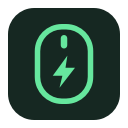
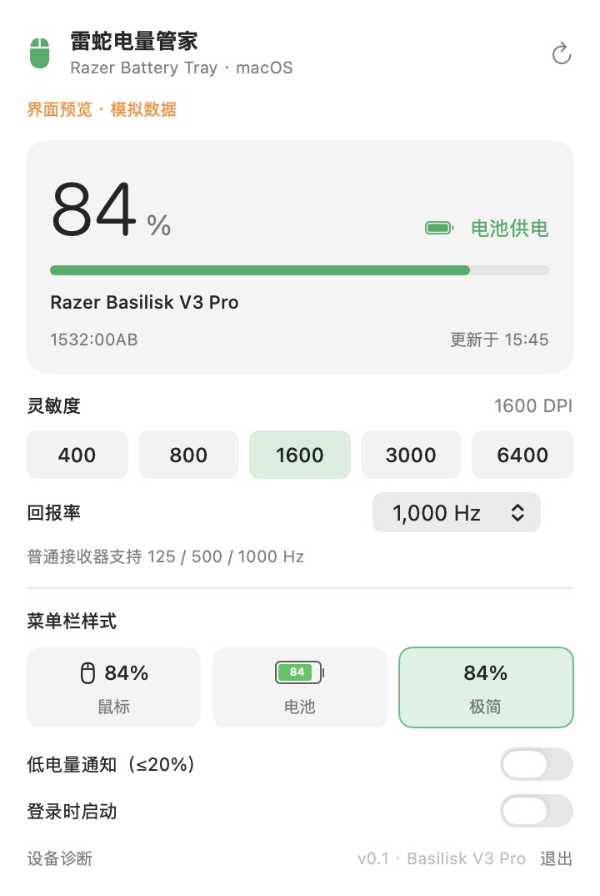

<p align="center">
  
</p>

<h1 align="center">RazerBatteryMenu</h1>

<p align="center">
  A native macOS menu bar battery and settings utility for the Razer Basilisk V3 Pro.
</p>

<p align="center">
  
  
  
  
</p>

<p align="center"><a href="README.md">简体中文</a> · English</p>

> [!IMPORTANT]
> This is an unofficial community project and is not affiliated with Razer Inc. The first release targets the standard Basilisk V3 Pro 2.4 GHz receiver (`1532:00AB`). Unknown product IDs are detected but never controlled automatically.



## Highlights

- Three menu bar styles with live battery level and charging state.
- DPI presets and 125 / 500 / 1000Hz polling-rate controls with read-back verification.
- Separate physical-disconnect and idle-sleep states; the last valid battery level is retained during sleep.
- HID activity callback for immediate refresh when the mouse wakes.
- Low-battery notifications, login launch, hot-plug reconnect, and Mac wake refresh.
- Native Swift, SwiftUI, AppKit, and IOKit implementation with no third-party dependencies.
- Fully local operation: no account, cloud service, telemetry, or network requests.

## Compatibility

| Device / connection | Product ID | Status |
|---|---:|---|
| Basilisk V3 Pro standard receiver | `1532:00AB` | Battery, charging, DPI, and polling rate verified on hardware |
| Basilisk V3 Pro wired | `1532:00AA` | Protocol implemented; more hardware validation needed |
| 35K / HyperPolling / other Razer devices | Other | Detection only; no control commands |
| Bluetooth | — | Not supported |

See [device support](docs/DEVICE_SUPPORT.md) for details.

## Install

1. Download the Apple Silicon DMG from [GitHub Releases](../../releases/latest).
2. Drag `RazerBatteryMenu.app` into Applications.
3. Grant Input Monitoring access in System Settings → Privacy & Security.

Development builds use ad-hoc signing unless a Developer ID is supplied. See the [installation guide](docs/INSTALLATION.md) for Gatekeeper and permission troubleshooting.

## Build from source

```bash
git clone https://github.com/Lixian666/RazerBatteryMenu.git
cd RazerBatteryMenu
bash scripts/test.sh
bash scripts/build.sh
open dist/RazerBatteryMenu.app
```

Requirements: macOS 13+, Xcode Command Line Tools, and Swift 5.9+. No external packages are downloaded.

Developer documentation:

- [Building](docs/BUILDING.md)
- [Release and deployment](docs/RELEASING.md)
- [Architecture](docs/ARCHITECTURE.md)
- [Privacy](docs/PRIVACY.md)

## Contributing

Bug fixes, protocol evidence, documentation, and hardware validation are welcome. Read [CONTRIBUTING.md](CONTRIBUTING.md) before submitting a change. Never attach device serial numbers or personal filesystem paths to an issue.

## License and credits

This project is an independent macOS implementation inspired by [Ferris-echo/RazerBatteryTray](https://github.com/Ferris-echo/RazerBatteryTray). It also uses publicly verifiable interoperability facts from OpenRazer without copying or linking its GPL driver code. See [THIRD_PARTY_NOTICES.md](THIRD_PARTY_NOTICES.md).

Released under the [MIT License](LICENSE).
