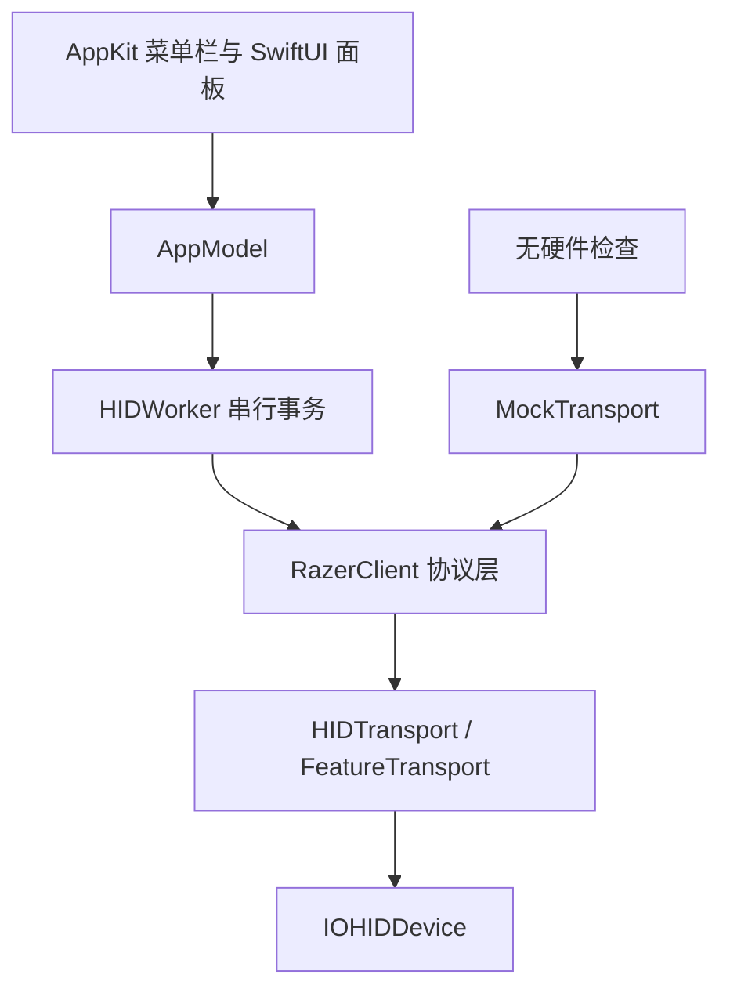
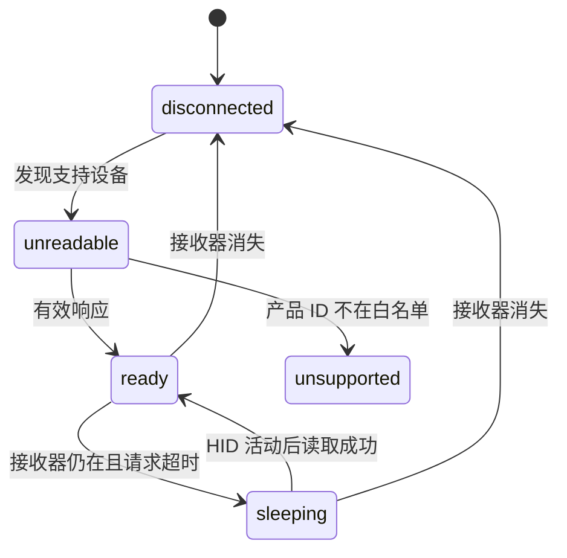

# 架构说明

## 分层

- **RazerCore**：90 字节命令、校验、重试、DPI / 回报率编码和设备状态。
- **RazerHID**：Razer VID 枚举、控制接口筛选、非独占打开和输入报告回调。
- **RazerBatteryMenu**：轮询、缓存、通知、登录项和界面状态。
- **RazerDiagnostics**：显式命令行诊断入口。

## 设备选择

枚举只匹配 Razer VID `0x1532`。控制命令还要求：

1. 产品 ID 位于明确白名单；
2. 传输为 USB；
3. 最大 Feature Report 为 90 字节；
4. 用户选择的设备身份与当前事务一致。

未知产品 ID 会出现在界面和诊断中，但不会构造 `RazerClient`。

## 事务与线程

`AppModel` 在主线程维护 UI 状态。所有 HID 查询和写入进入一个串行 DispatchQueue，`HIDWorker` 再用锁保护完整的发送、等待、读取和验证事务。设置写入结束后立即读回，只有匹配才报告成功。

输入报告回调只作为“设备有活动”的信号。它不保存报告内容，并且只在状态为休眠时触发电量刷新，避免鼠标移动导致持续控制查询。

## 状态模型

休眠要求存在同一设备的历史有效读数。物理断联会清除当前读数；普通读取失败会保留最后有效读数但标记“暂不可读”。

## 本地数据

UserDefaults 保存菜单栏样式、首选设备、通知开关、登录项状态辅助信息和各设备最后有效读数。设备身份优先使用 USB location ID，不记录 HID 序列号。
